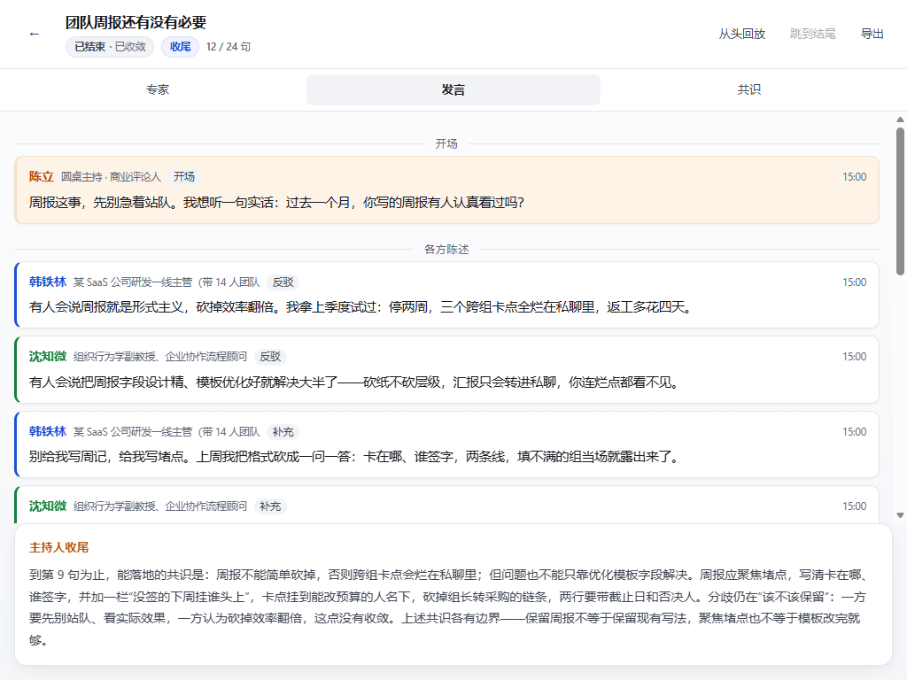
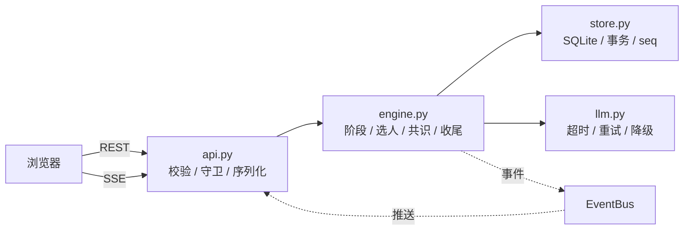

# AI Panel Studio · 虚拟专家圆桌

给一个议题，系统现场组一支立场互不相同的虚拟专家局。一位主持人加 2-6 位专家，
他们自己抢发言权、互相反驳、逐步收敛出共识与分歧 —— 你负责围观。

不是聊天框：这是一场**有阶段、有秩序、会结束**的讨论。每条发言都来自一次真实的模型调用，
内部状态（谁在准备发言）只出现在侧边小窗，永远不混进正文。


---

## 快速开始

需要 Python 3.11+ 与 Node 18+。

```bash
# 1. 建库（5 场样例：2 场已结束、3 场待确认）
python scripts/init_db.py --force

# 2. 后端（Key 只在环境变量里，绝不入库、绝不回显）
export PANEL_LLM_KEY=sk-xxxxxxxx        # Windows: set PANEL_LLM_KEY=...
python backend/main.py                  # http://127.0.0.1:8000

# 3. 前端
cd frontend && npm install && npm run dev   # http://127.0.0.1:5173
```

可换模型供应商（OpenAI 兼容端点即可）：

```bash
export PANEL_LLM_BASE=https://dashscope.aliyuncs.com/compatible-mode/v1
export PANEL_LLM_MODEL=qwen-plus
export PANEL_PORT=8000
```

**没配 Key 也能跑**：阵容走确定性角度池，发言连续失败 3 次后以 `ended_reason=degraded` 收尾。
界面会明确写"模型异常，降级收尾"，不会假装讨论成功 —— 见 `docs/screenshots/05-degraded.png`。
降级那一屏是**五处口径一起改**的：状态条、失败提示、发言区、共识区、专家席都按"已结束"说话，
不会出现顶上写"已结束"、中间还写"讨论还没开始"的情况。

---

## 界面

| 首页 | 阵容确认 |
|---|---|
|  |  |

| 已结束回看（三区：专家席 / 发言 / 共识） | 窄屏（三区变页签） |
|---|---|
|  |  |

---

## 验证（四条命令）

```bash
# 后端单元 + 接口 + 两侧事件一致性（114 条）
cd backend && python -m pytest

# 前端：边界适配层 + SSE 连接状态（22 条）
cd frontend && npm test

# 界面门禁：四个宽度查横向溢出 / 整页滚动 / 三栏撑满 / 原始 JSON 泄漏 / 发言超长 / 控制台报错
python scripts/check_ui.py --base http://127.0.0.1:5173 --did d_01

# 端到端真实跑一场，二十余条断言（会消耗模型额度）
python scripts/e2e_run.py --topic "公司该不该推行四天工作制" --experts 4
```

判定标准统一是 **`EXIT=0` 且 `★=0`**。门禁脚本自己报错也算红，不静默跳过。

新增的机制一律先注入缺陷验证它会红，再还原 —— 否则"测试全绿"可能只是测试没测到。
这条规矩在本次开发里至少四次直接改变了结论（见 `docs/06-开发说明.md` 第 7 节的踩坑表）。

---

## 它是怎么组织的



三条边界值得说：

1. **模型只说话，不决定流程。** 谁下一个发言、什么时候结束、共识版本是多少，全由代码裁决。
   让模型决定顺序，它会偏爱话多的角色、绕开尖锐问题，而且不可复现。
2. **共识只有一个来源。** `consensus_state` 一张表，页面面板与收尾总结读的是同一份数据。
   收尾 prompt 刻意不传 transcript —— 让两处"物理上只有一份可读输入"，比要求它们写一致可靠。
3. **直播、断线补发、结束回看共用一条渲染管线。** 三者都是"连上同一根 SSE + `applyEvent`"，
   回看只是服务端把历史补发到末尾再关闭。结构上不存在"直播有、回放丢"的缝。

---

## 目录

```
db/           schema.sql（6 表 + 触发器）· seed.sql（5 场样例）
docs/         01 PRD · 02 SCHEMA · 03 API · 04 计划 · 05 UI · 06 开发说明 · 07 核心 Prompt · 08 已完成与未完成
backend/app/  api / engine / scheduler / personas / consensus / content / lineup / store / llm
frontend/src/ lib（api / adapter / types / router / format）· pages · components · styles
scripts/      init_db · e2e_run · check_ui · shot
```

四个阶段与产出物的对应关系见 `docs/04-PLAN.md`；为什么代码长成这样见 `docs/06-开发说明.md`；
开发过程用的 Prompt 与踩过的坑见 `docs/07-核心Prompt记录.md`；
哪些没做、做到什么程度见 `docs/08-已完成与未完成.md`。

---

## 技术栈

后端 FastAPI + SQLite（WAL）+ 原生 SSE，无 ORM、无任务队列、无前端 UI 库。
前端 React 18 + TypeScript + Vite，运行时依赖只有 `react` / `react-dom` ——
路由 40 行自己写，状态演进收在一个纯函数 `applyEvent` 里。

## 已知限制

- 无鉴权，单人演示用；多人协作需要加会话与配额
- `EventBus` 是进程内队列，多 worker 部署时订阅者收不到别的进程的事件
- 共识按固定间隔抽取（每 4 句），不判断"是否值得抽"
- 发言不可编辑、不可删除；导出只有 markdown
- prompt 只带最近 6-10 句，更早的上下文靠 `consensus_state` 承载
