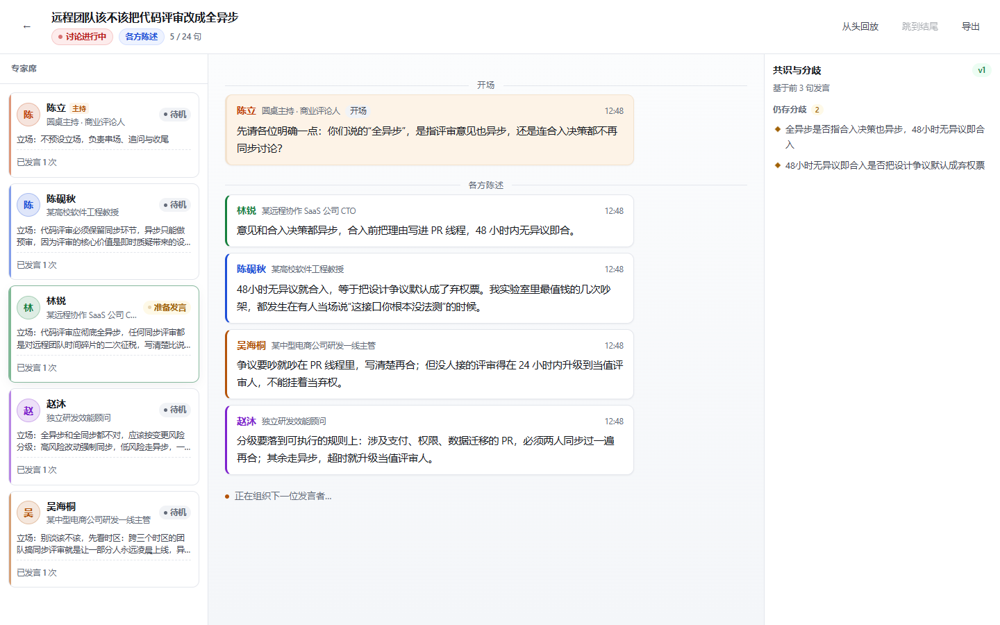
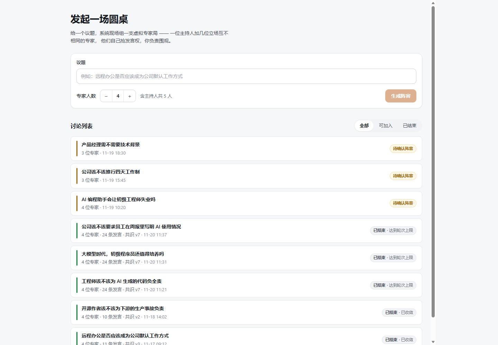
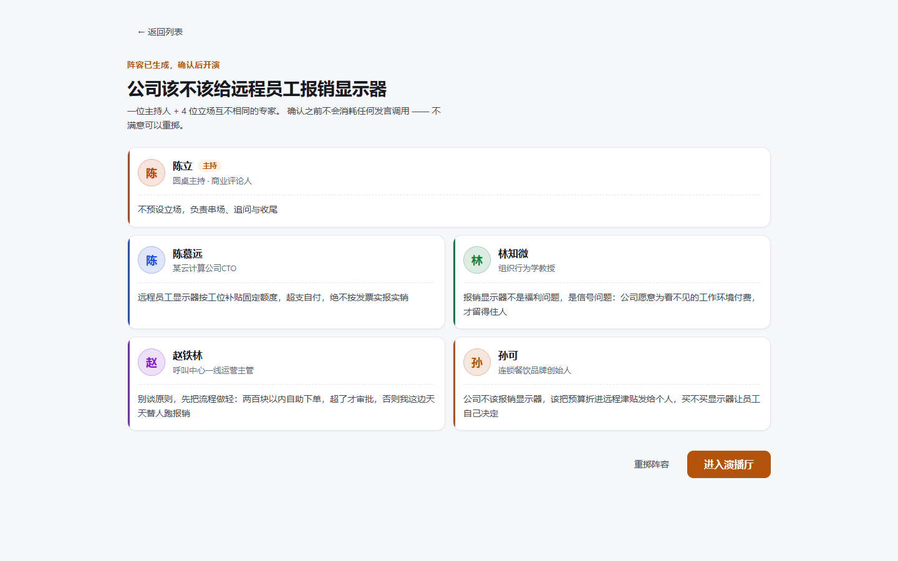
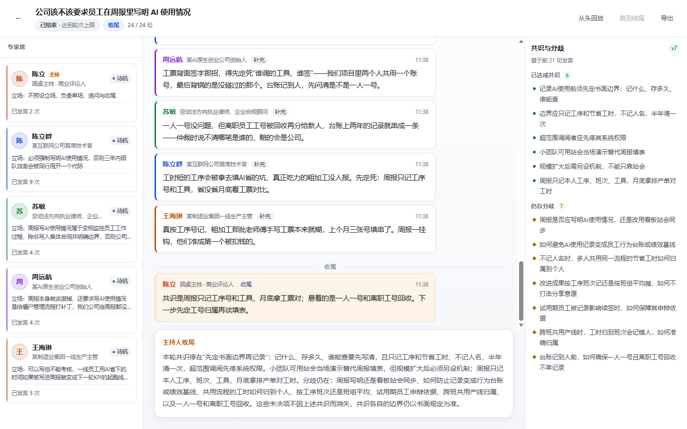
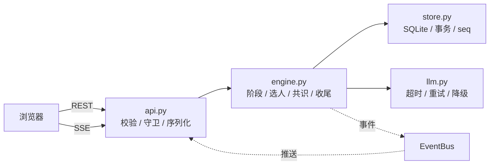

# AI Panel Studio · 虚拟专家圆桌

给一个议题，系统现场组一支立场互不相同的虚拟专家局。一位主持人加 2-6 位专家，
他们自己抢发言权、互相反驳、逐步收敛出共识与分歧 —— 你负责围观。

不是聊天框：这是一场**有阶段、有秩序、会结束**的讨论。每条发言都来自一次真实的模型调用，
内部状态（谁在准备发言）只出现在侧边小窗，永远不混进正文。



---

## 快速开始

需要 Python 3.11+ 与 Node 18+。

```bash
# 1. 建库（5 场样例：2 场已结束、3 场待确认）
python scripts/init_db.py --force

# 2. 后端（Key 只在环境变量里，绝不入库、绝不回显）
export PANEL_LLM_KEY=sk-xxxxxxxx        # Windows: set PANEL_LLM_KEY=...
python backend/main.py                  # http://127.0.0.1:8000

# 3. 前端
cd frontend && npm install && npm run dev   # http://127.0.0.1:5173
```

可换模型供应商（OpenAI 兼容端点即可）：

```bash
export PANEL_LLM_BASE=https://dashscope.aliyuncs.com/compatible-mode/v1
export PANEL_LLM_MODEL=qwen-plus
export PANEL_PORT=8000
```

**没配 Key 也能跑**：阵容走确定性角度池，发言连续失败 3 次后以 `ended_reason=degraded` 收尾。
界面会明确写"模型异常，降级收尾"，不会假装讨论成功 —— 见 `docs/screenshots/05-degraded.png`。
降级那一屏是**五处口径一起改**的：状态条、失败提示、发言区、共识区、专家席都按"已结束"说话，
不会出现顶上写"已结束"、中间还写"讨论还没开始"的情况。

---

## 界面

| 首页 | 阵容确认 |
|---|---|
|  |  |

| 已结束回看（三区：专家席 / 发言 / 共识） | 窄屏（三区变页签） |
|---|---|
|  |  |

---

## 验证（四条命令）

```bash
# 后端单元 + 接口 + 两侧事件一致性（117 条）
cd backend && python -m pytest

# 前端：边界适配层 + SSE 连接状态（22 条）
cd frontend && npm test

# 界面门禁：四个宽度查横向溢出 / 整页滚动 / 三栏撑满 / 原始 JSON 泄漏 / 发言超长 / 控制台报错
python scripts/check_ui.py --base http://127.0.0.1:5173 --did d_01

# 端到端真实跑一场，二十余条断言（会消耗模型额度）
python scripts/e2e_run.py --topic "公司该不该推行四天工作制" --experts 4
```

判定标准统一是 **`EXIT=0` 且 `★=0`**。门禁脚本自己报错也算红，不静默跳过。

新增的机制一律先注入缺陷验证它会红，再还原 —— 否则"测试全绿"可能只是测试没测到。
这条规矩在本次开发里至少四次直接改变了结论（见 `docs/06-开发说明.md` 第 7 节的踩坑表）。

---

## 它是怎么组织的



三条边界值得说：

1. **模型只说话，不决定流程。** 谁下一个发言、什么时候结束、共识版本是多少，全由代码裁决。
   让模型决定顺序，它会偏爱话多的角色、绕开尖锐问题，而且不可复现。
2. **共识只有一个来源。** `consensus_state` 一张表，页面面板与收尾总结读的是同一份数据。
   收尾 prompt 刻意不传 transcript —— 让两处"物理上只有一份可读输入"，比要求它们写一致可靠。
3. **直播、断线补发、结束回看共用一条渲染管线。** 三者都是"连上同一根 SSE + `applyEvent`"，
   回看只是服务端把历史补发到末尾再关闭。结构上不存在"直播有、回放丢"的缝。

---

## 目录

```
db/           schema.sql（6 表 + 触发器）· seed.sql（5 场样例）
docs/         01 PRD · 02 SCHEMA · 03 API · 04 计划 · 05 UI · 06 开发说明
              07 核心 Prompt · 08 已完成与未完成 · 09 工作流说明 · screenshots/
backend/app/  api / engine / scheduler / personas / consensus / content / lineup / store / llm
frontend/src/ lib（api / adapter / types / router / format）· pages · components · styles
scripts/      init_db · e2e_run · check_ui · shot · pack
```

四个阶段与产出物的对应关系见 `docs/04-PLAN.md`；为什么代码长成这样见 `docs/06-开发说明.md`；
开发过程用的 Prompt 与踩过的坑见 `docs/07-核心Prompt记录.md`；
哪些没做、做到什么程度见 `docs/08-已完成与未完成.md`。

---

## 技术栈

后端 FastAPI + SQLite（WAL）+ 原生 SSE，无 ORM、无任务队列、无前端 UI 库。
前端 React 18 + TypeScript + Vite，运行时依赖只有 `react` / `react-dom` ——
路由 40 行自己写，状态演进收在一个纯函数 `applyEvent` 里。

## 主要 API

八个端点，全部在 `docs/03-API.md` 有完整的请求/响应/错误码。这里只列形状：

| 方法 | 路径 | 作用 |
|---|---|---|
| `GET` | `/api/health` | 存活 + 模型连通性（前端顶部的"模型在线"来自这里） |
| `GET` | `/api/discussions` | 讨论列表 |
| `POST` | `/api/discussions` | 创建讨论 → 现场生成阵容 |
| `POST` | `/api/discussions/{id}/regenerate` | 重掷阵容（仅 `AWAITING_CONFIRM` 状态允许） |
| `POST` | `/api/discussions/{id}/start` | 确认阵容，开始讨论 |
| `GET` | `/api/discussions/{id}` | 全量快照（阵容 + transcript + 共识 + 状态） |
| `GET` | `/api/discussions/{id}/stream` | **SSE 事件流**（直播、断线补发、回看共用） |
| `GET` | `/api/discussions/{id}/export` | 导出 markdown |

SSE 一共七种事件，前端只认这七种：

| 事件 | 何时发 | 谁在消费 |
|---|---|---|
| `phase` | 阶段切换 | 顶部阶段指示 |
| `panelist_state` | 待机 / 准备发言 / 发言中 | **只进侧边小窗**，永不进正文 |
| `utterance` | 一条发言完成 | 只进 transcript |
| `consensus` | 共识版本更新 | 右侧共识面板 |
| `ended` | 讨论结束 | 收尾提示，带 `reason` |
| `error` | 单次调用失败但可继续 | 面板角标，不打断讨论 |
| `ping` | 每 15s | 保活注释，**不入事件表** |

`id:` 是事件序号，客户端断线后带 `Last-Event-ID` 重连即从下一条补发 ——
所以"直播"和"回看"用的是同一条管线，不存在两套渲染逻辑。

---

## 已完成能力与后续改进方向

### 已经能用的

- 议题 → 现场生成阵容（模型生成 + 代码校验立场互斥；模型不可用时回退确定性角度池）
- 阵容确认页可重掷，确认后才开始调用模型（确认前不烧额度）
- 四阶段讨论：开场 → 各方陈述 → 交锋 → 收尾，阶段由代码裁决、不由模型决定
- 每个专家带可被反驳的靶子（`target`），实测每场 5-8 句真正在反对
- 共识与分歧实时更新（v1 起每版可追溯），收尾前补抽一次保证总结不落后于正文
- 两种结束方式：自然收敛（连续两版收口且已过交锋）或撞 24 轮上限，`ended_reason` 必落库
- 断线重连不重不漏；回看与直播共用事件流
- 三级降级：阵容回退 → 单句跳过 → 连续失败降级收尾（界面如实说"未形成可记录的共识"）
- 窄屏三区变页签；四宽度门禁守住无横向溢出、无整页滚动、发言不超长

### 已知限制（不打算在这版修）

- 无鉴权，单人演示用；多人协作需要加会话与配额
- `EventBus` 是进程内队列，多 worker 部署时订阅者收不到别的进程的事件
- 共识按固定间隔抽取（每 3 句），不判断"是否值得抽"
- 发言不可编辑、不可删除；导出只有 markdown
- prompt 只带最近 6-10 句，更早的上下文靠 `consensus_state` 承载

### 下一步该做的（按价值排序）

1. **交锋还能更强**：现在反驳靠人设里的靶子驱动，话题偏"管理流程"时仍会滑向补充会
2. **意图分类该换判据**：现在是关键词表，prompt 一改措辞它就漏判，应按结构关系判
   （这句话是否复述了某人的立场再否定），而不是匹配词
3. **共识抽取时机**：可以试"检测到观点变化才抽"，但判断本身又要一次调用，目前划不来
4. 多人协作 / 权限 / 配额
5. 导出 PDF、发言可编辑（都要动数据模型，不是加个按钮的事）

每一项的实测依据和反面例子都在 `docs/08-已完成与未完成.md`。

---

## 交付物对照

作业原文「3. 交付物要求（缺任意一项视为不合格）」下共 **3 项**，逐条对照：

| # | 要求 | 在哪 | 状态 |
|---|---|---|---|
| 1 | 完整项目源码（GitHub/Gitee 链接） | 本仓库 `backend/` + `frontend/` + `db/` + `scripts/` | ✅ 提交历史按 docs/schema → ui-components → tests → feat: logic 分层 |
| 1a | 数据库初始化脚本 | `scripts/init_db.py --force`，DDL 在 `db/schema.sql` | ✅ 建表 + 触发器 + 5 场样例，末尾自检 `seq` 连续 |
| 1b | ≥ 5 条高质量样例数据（议题 + 嘉宾阵容） | `db/seed.sql` | ✅ 5 场：2 场已结束（含共识与分歧）、3 场待确认 |
| 1c | 开发文档（md + mermaid，PRD / ER 等） | `docs/01`–`05` + `06` 开发说明 | ✅ 先写契约后写代码 |
| 1d | API 文档 | `docs/03-API.md` + 本文档「主要 API」 | ✅ 完整请求/响应/错误码 |
| 1e | 测试代码 | `backend/tests/`（117 条）+ `frontend/src/lib/__tests__/` | ✅ 含两侧事件形状一致性用例 |
| 1f | README（运行指南 / 环境变量 / 技术选型 / 主要 API / 已完成能力与改进方向） | 本文档 | ✅ 五要素齐全 |
| 1g | Git Commit 演进历史分层 | `git log` | ✅ 按 docs → UI → 测试 → 实现推进 |
| 2 | 核心 Prompt 记录文档（**必须 ≥ 5 段**，每段标开发范式：SDD / DDD / TDD / E2E，段后附 1–2 句说明） | `docs/07-核心Prompt记录.md` | ✅ P1–P6 六段，覆盖四个范式，每段含「意图 / 约束 / 产出 / 挑战 / 如何修正」 |
| 3 | 开发过程思路 & 工作流说明（1–1.5 页） | `docs/09-工作流说明.md` | ✅ 开发流程、2–3 个典型问题、对「工程化 AI 开发」的理解 |

提交方式是邮件：`xulei@wisquest.com`，主题含 zip 包 + 文档 + GitHub/Gitee 邀请，截止为收到后 72 小时。

> 说明：作业原文**未要求**录制演示视频。本仓库不声称有、也不列为未完成项。
> 界面证据由 `docs/screenshots/` 六张截图与 `scripts/e2e_run.py` 的真实跑测记录承担。

打包命令：

```bash
python scripts/pack.py          # → ../交付/AI圆桌讨论-张宇翔-20230308060.zip
```

只装 git 追踪的文件，`node_modules` / `.venv` / 数据库 / 日志一律不进包；
缺少 `docs/09` 或 `db/seed.sql` 这类硬性文件时脚本直接报错退出，不会打出一个"看起来完整"的包。
