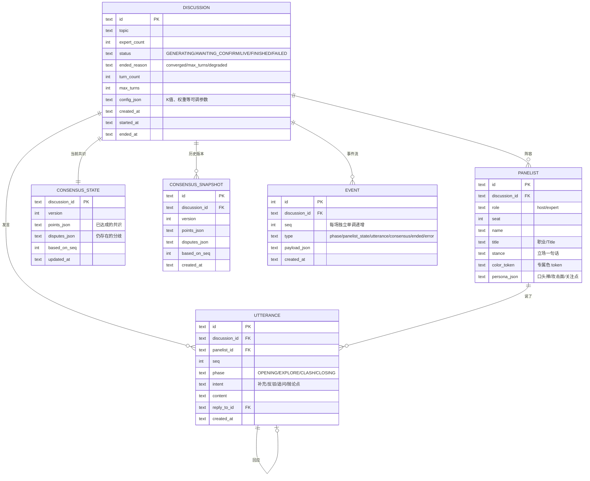
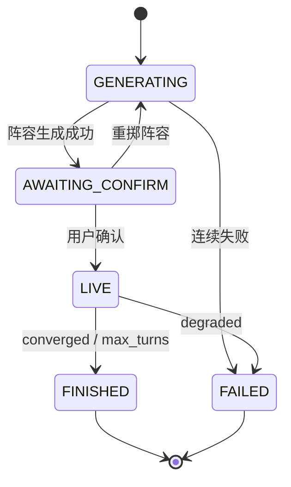
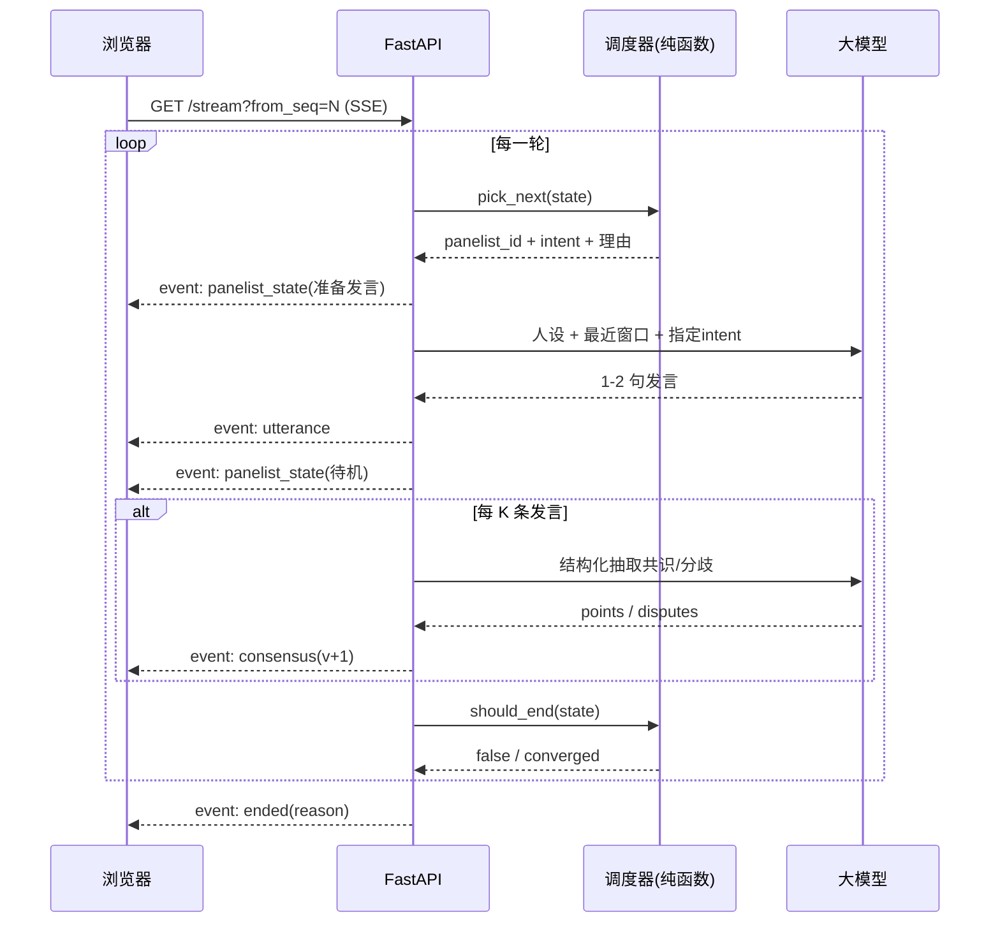

# 数据模型与状态机

> 阶段：SDD-2 ｜ 数据库：SQLite（需求硬性规定）

---

## 1. 设计原则

1. **一切以 `discussion_id` 为隔离边界**。多场讨论并行时，任何查询都必须带这个条件，杜绝跨场串流。
2. **内部事件不入 transcript**。"举手/让位"只进 `event` 表，`utterance` 表结构上就没有这类字段。
3. **事件表是唯一的重放源**。页面刷新、断线重连、结束后回看，都靠 `event.seq` 单调递增重放。
4. **共识状态带版本号**。每次抽取产生新版本，页面显示 `v3` 这种编号，评审一眼能看出"是实时更新的"。

---

## 2. ER 图

---

## 3. 索引与约束

| 约束 | 说明 |
|---|---|
| `UNIQUE(discussion_id, seq)` on `EVENT` | 保证事件流可重放、可去重 |
| `UNIQUE(discussion_id, seat)` on `PANELIST` | 座位唯一，颜色按座位分配 |
| `INDEX(discussion_id, created_at)` on `UTTERANCE` | 按场次取 transcript |
| `CHECK(status IN (...))` | 状态机非法值入库即报错 |
| `CONSENSUS_STATE` 以 `discussion_id` 作主键 | 天然保证"一场只有一个当前版本" |

---

## 4. 讨论状态机

**关键点**：`AWAITING_CONFIRM` 是独立状态，不是"LIVE 的一个开关"。因为用户可能在确认前反复重掷阵容，这段不能开始烧模型。

---

## 5. 单轮发言的时序（调度核心）

注意图中顺序：`panelist_state(准备发言)` **先于** `utterance` 发出，这样侧边小窗的"准备发言 → 发言中"是真的跟时间走的，而不是事后补的动画。

---

## 6. 回放机制

- `event` 表按 `discussion_id` 存全量事件，`seq` 从 0 递增。
- 前端重连时带 `from_seq`，服务端从该位置续推；`from_seq=0` 即完整回放。
- 回放与直播走**同一套事件类型**，前端只有一条渲染管线。这样"回放"不需要额外开发，且不会出现"直播能看、回放丢东西"。
