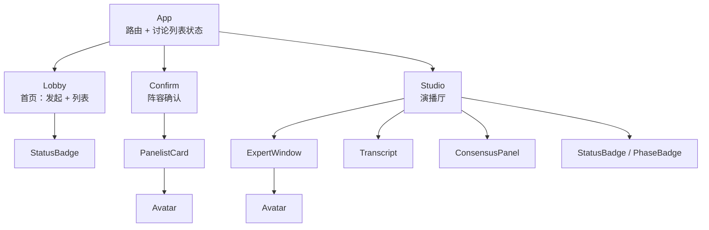
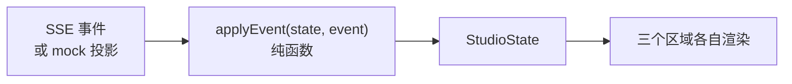

# 前端设计说明

> 阶段：DDD ｜ 对应提交：`chore(ui)` → `feat(ui)` ×3
> 截图见 `docs/figs/`

---

## 1. 技术选型

React 18 + TypeScript + Vite，**零 UI 库、零图表库、零路由库**。

| 选择 | 理由 |
|---|---|
| 不引 UI 组件库 | 需求要求 2 秒内 FCP。一个 UI 库动辄 200KB+，为了几个按钮和弹窗不值 |
| 不引路由库 | 全站只有三个视图，自己写 40 行 hash 路由足够，省下一个依赖 |
| 不引图表库 | 本项目没有图表，所有视觉元素都是 CSS + 内联 SVG |
| hash 路由 | 静态托管即可，不需要服务端 rewrite 规则，本地跑也更简单 |

构建产物：React 45KB + 应用 10.5KB + 样式 3.8KB（gzip），首屏不依赖任何外部请求。

---

## 2. 组件树



**分层的意义**：`ExpertWindow`、`Transcript`、`ConsensusPanel` 三者互相不知道对方存在，
各自只吃自己那份数据。这样才能单独验证「不给事件它就不动」——
把 `ExpertWindow` 拎出来渲染，它永远停在「待机」，没有任何自演的余地。

---

## 3. 三区布局

桌面（≥1100px）：

```
┌──────────────────────────────────────────────────────┐
│ 顶部：议题 · 状态 · 阶段 · 进度 · 回放控制            │
├──────────┬────────────────────────┬──────────────────┤
│ 专家席   │ 现场发言（transcript）  │ 共识与分歧       │
│ 300px    │ flex:1                 │ 340px            │
│ 独立滚动 │ 独立滚动               │ 独立滚动          │
└──────────┴────────────────────────┴──────────────────┘
```

- `html, body, #root` 全部 `overflow: hidden`，**整页永远不滚**。
- 三个 `.pane` 各自 `overflow-y: auto`，滚动条互不影响。
- 超宽屏（≥1800px）把两侧留白吃进舞台，避免 transcript 行长过长。

窄屏（<1100px）：三区变成页签「专家 / 发言 / 共识」，一次只显示一个，
同样不产生整页滚动。之所以不做「三区纵向堆叠」，是因为堆叠必然导致整页滚动，
直接违反需求。

---

## 4. 状态流转



`applyEvent` 是唯一的写入口。直播、断线重连补发、结束后回放，三条路径
喂的是同一批事件、走同一个函数、渲染同一个界面。

**这也是「不能前端做仿真」的技术保证**：组件里没有任何 `setInterval` 去"造"一条发言。
把事件流停掉，画面就停在最后一帧，不会自己往下演。

---

## 5. 颜色分配

- 每位嘉宾一个 `color_token`，存在数据库 `panelist.color_token`，由座位号决定。
- 同一场内颜色、座位、立场三者都由 `init_db.py` 自检保证互不重复，
  不会出现「两位专家一个色」。
- 全站单色体系（浅色底）。没有做深色舞台，理由写在 `tokens.css` 顶部注释里：
  深色会让专属色被迫分叉成两套值，最后一定出现读不清的组合。

---

## 6. 空态规则

这是上一类项目踩过的坑，写进规则：

| 场景 | 不许 | 必须是 |
|---|---|---|
| 共识版本为 0 | 留白 | 显示「尚未形成」，并说明累积 4 句后首次更新 |
| 己方发言数 0 | 只显示数字 0 旁边什么都没有 | 「已发言 0 次」完整句子 |
| transcript 为空 | 空容器 | 「讨论还没开始，第一条发言出现后这里会实时滚入」 |
| 筛选无结果 | 空白页 | 「这个筛选下没有讨论。换个筛选，或者在上面发起一场」 |

**理由**：「值等于 0」和「数据没取到」在界面上长得一模一样，
而后者是缺陷。让 0 明确说话，缺陷才会显形。

---

## 7. 首屏 FCP 的三项措施

1. **内联骨架**：`index.html` 里直接写首屏结构和关键 CSS，JS 还没下载完就已经有内容。
   SPA 默认是白屏等 JS，而需求写死「不能出现空白屏」。
2. **拆 chunk**：React 单独一个 chunk，应用代码单独一个，样式单独一个。
   首屏只需要 HTML + CSS 就能上色。
3. **零外部请求**：没有字体 CDN、没有图标库、没有图片资源，头像用姓名首字 + 颜色生成。

---

## 8. 已完成的验证

| 项 | 方式 | 结果 |
|---|---|---|
| 类型检查 | `npx tsc --noEmit`（strict + noUncheckedIndexedAccess） | 通过 |
| 构建 | `npx vite build` | 通过，60KB gzip |
| 桌面三区 | 1440×900 截图 | 三区独立滚动、无整页滚动条 |
| 窄屏页签 | 900×820 截图 | 页签生效，单区显示 |
| 确认页 | 1440×900 截图 | 立场可读、按钮对齐 |

截图：`docs/figs/01-lobby.png`、`02-confirm.png`、`03-studio.png`、`04-studio-narrow.png`
