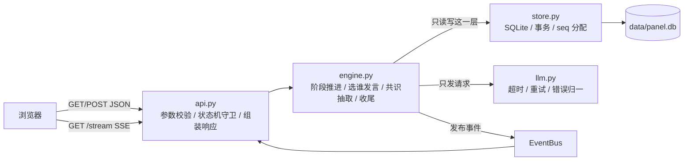

# 开发说明

> 这份文档回答一个问题：**为什么代码长成这样**。
> 它不是 API 手册（那是 `03-API.md`），也不是需求说明（那是 `01-PRD.md`），
> 而是把"当时有哪些选项、为什么选了这一个、选错之后怎么发现的"记下来。

---

## 1. 一句话架构



四条边界是硬的，越界就会出问题：

| 层 | 只做 | **不做** |
|---|---|---|
| `api.py` | 校验、守卫、序列化、把事件转成 SSE | 任何"谁该发言""是否结束"的判断 |
| `engine.py` | 业务决策、写事件 | 拼 SQL、拼 HTTP |
| `store.py` | 事务、seq、快照 | 业务规则 |
| `llm.py` | 发请求、超时、错误归一 | prompt 拼装、解析业务语义 |

**为什么把 `api.py` 的职责压到这么薄**：一旦"是否结束"在 HTTP 层也判一次，就会出现两处实现，
而两处实现必然在某次改动后不一致 —— 上一个项目里"同一屏两套口径"是复发率最高的缺陷，这里从分层上避免。

---

## 2. 三条核心决策（每条都有代价）

### D1 结束条件：软收敛 + 硬上限 24 轮

**选的**：每 K 条发言抽一次共识，连续两轮 `disputes` 为空即判收敛；同时硬上限 24 轮，到点强制收尾。
结束原因必须落 `ended_reason ∈ {converged, max_turns, degraded}`。

**为什么不只靠模型说"可以结束了"**：模型天然倾向于一直聊下去（它没有成本感）。
把结束权交出去，最坏结果是跑满上下文然后崩掉，演示时表现为"卡住不动"。

**代价**：可能出现"其实已经聊透了但还在聊"的几轮。接受 —— 那只是多花几秒，
而"卡住"是事故。

数据上还加了一道保险：`ended_reason` 由 SQL 触发器守——`status='FINISHED'` 而 `ended_reason IS NULL` 的写入直接 ABORT。

### D2 发言顺序：模型提议 + 纯函数裁决

**选的**：`scheduler.pick_next(seats, turns, phase, seed)` 返回"下一位是谁、在回应哪一句"。
模型只负责**写**这句话，不负责**决定**轮到谁。

**为什么**：让模型决定顺序，三个必然结果 ——
① 它会偏爱话多的角色（同一人被反复点名）；
② 它会跳过尖锐的问题（避重就轻）；
③ 顺序不可复现，出问题查不出来。

**代价**：需要自己设计"谁更该说"的规则（话题相关度 + 抢话倾向 + 冷却），这块要写测试。

### D3 共识：单一真相源

**选的**：`consensus_state` 一张表存 `points / disputes / version / based_on_seq`。
收尾总结**只注入这一份**，不重新读 transcript 抽取一遍。

**为什么**：如果总结时重新抽取，屏幕上显示的共识和总结里说的共识会是两拨内容 ——
"屏幕上一套、文档里一套"是最难解释的缺陷。

**代价**：抽取 prompt 必须同时承担"合并旧共识"的职责，不能只做一次性摘要。

---

## 3. 事件模型：为什么是这套形状

### 3.1 为什么 SSE 而不是 WebSocket

需求是**单向**推送（服务端说、浏览器听），且必须能**断线补发**。
SSE 自带 `Last-Event-ID` 重连语义、走普通 HTTP（不用过代理的白名单）、`EventSource` 自动重连。
WebSocket 需要自己实现序号、补发、心跳三件事，收益为零。

### 3.2 为什么 `seq` 和 `utterance_seq` 必须分开

一条发言会伴生 3 个事件：`panelist_state(准备发言)` → `utterance` → `panelist_state(待机)`。
所以第 7 句发言对应的事件序号可能是 20。

早期版本两个都叫 `seq`，于是前端把"第几个事件"当成"第几句"用了，
表现是"回应第 5 句"指向了一条不相干的发言。现在：
- `event.seq`：SSE 的 `id:`，用于重连定位，连续无洞
- `utterance.utterance_seq`：第几句，从 1 开始
- `reply_to_utterance_seq`：在回应第几句（不是第几个事件）

`frontend/src/lib/adapter.test.ts` 里有一条用例专门钉这件事：断言两者**不相等**。
这条用例做过缺陷注入验证——把 `utterance_seq` 改成帧 `seq`，测试立刻红。

### 3.3 为什么序号从 1 起

`/stream?from_seq=0` 的查询是 `WHERE seq > from_seq`。
投影脚本早期用 `enumerate(events)` 从 0 起，运行时引擎从 1 起 —— 于是**回看时第一帧（开场阶段）被静默过滤**，
界面上永远看不到"开场"。两侧统一到 1，并由 `init_db.py` 自检 + `test_event_shape_parity.py` 双重守住。

### 3.4 为什么 `ping` 不算事件

保活是"这条连接还活着"的传输层信号。把它写进 `event` 表，回放昨天的讨论时会重放出一堆昨天的 ping，
毫无意义且污染 seq。所以它以 SSE 注释行 `: ping\n\n` 发出，不占 seq、不入库，
`event.type` 的 CHECK 约束里也刻意不含 `ping`。

### 3.5 为什么回看也走事件流

已结束的讨论，前端不是去读快照渲染，而是**连同一根 SSE，服务端把历史补发到末尾然后关闭**。
这样"直播"和"回放"共用 `applyEvent` 一条渲染管线，结构上不存在"直播有、回放丢"的缝。

代价是回看要经过一次网络往返（几百毫秒），换来的是三份渲染代码变成一份。

---

## 4. 失败路径：模型挂了会怎样

| 失败点 | 处理 | 用户看到 |
|---|---|---|
| 阵容生成失败 | 回退确定性角度池（6 个互斥视角），`lineup_source=template` | 确认页照常出阵容 |
| 单句生成失败 | 重试 2 次 → 跳过该句、记 `error` 事件、仍然推进轮次 | 一句提示"有 N 句生成失败，已跳过" |
| 连续失败 ≥3 次 | `ended_reason=degraded`，用已有共识写收尾 | 角标"已结束 · 模型异常，降级收尾" |
| 共识抽取失败 | 保留上一版共识，记 `error` 事件 | 共识面板停在上一版，不倒退 |
| 引擎整体异常 | `ENGINE_CRASH` 事件 + 降级收尾 | 不会出现永远 `LIVE` 的僵尸场次 |

**真实证据**：用一把无效密钥跑 `scripts/e2e_run.py`，得到的是
`ended_reason=degraded`、`0` 句发言、收尾文本"讨论因模型调用连续失败而提前结束，未形成可记录的共识"。
这不是设计文档里的想象，是实测结果（`docs/screenshots/05-degraded.png`）。

三个设计要点：
- **失败也必须结束**。绝不允许停在 `LIVE` 等一个不会来的事件。
- **跳过而不是重试到死**。连续失败说明是配置/额度问题，再重试只是拖长演示的等待。
- **收尾文本要诚实**。降级收尾不许编造"双方达成了共识"。

---

## 5. 前端：为什么几乎没有依赖

`package.json` 的运行时依赖只有 `react` 和 `react-dom`。没有路由库、没有状态管理、没有图表库、没有 UI 组件库。

| 常见依赖 | 这里怎么做 | 理由 |
|---|---|---|
| react-router | `lib/router.ts`，40 行 hash 路由 | 只有三个视图，引一个几十 KB 的库拖累首屏 |
| zustand/redux | `App.tsx` 的 `useState` + `applyEvent` | 状态真的很少，且演进规则已经收在一个纯函数里 |
| UI 组件库 | `styles/tokens.css` 一套设计 token | 要的是"每个人一个专属色"这种定制，组件库反而要覆盖 |

### 5.1 `applyEvent` 是唯一的写入口

```ts
function applyEvent(state: StudioState, event: StudioEvent): StudioState
```

直播、断线补发、结束回看三条路径都调它。**如果哪天发现某处界面在直接改 `state`，那就是缺陷入口**。

### 5.2 三区独立滚动怎么实现的

```
.studio { height: 100vh; display: grid; grid-template-rows: auto auto 1fr; }
.studio-body { display: grid; grid-template-columns: 260px 1fr 320px; min-height: 0; }
.pane { min-height: 0; }         /* ← 关键：不写就没法在 flex/grid 里滚动 */
.pane-scroll { overflow-y: auto; }
```

`min-height: 0` 是最容易漏的一行：默认 `min-height: auto` 会让子元素撑破容器，
于是整页出现滚动条、三个区的滚动失效。窄屏（<1100px）三区变成页签，同一时刻只显示一个。

### 5.3 边界适配层

后端字段由 SQL 列名决定（`utterance_seq` / `panelist_id`），组件要的是嵌套 camelCase。
转换全部收在 `lib/adapter.ts`，且**只处理形状**：

- 缺失字段给安全默认值（列表少一个计数不该白屏）
- 未知事件类型返回 `null`（后端加新事件，老前端忽略而不是崩）
- 未知状态落到 `FAILED` 而不是 `LIVE`（后者会让界面去连一条不会结束的流）
- `based_on_seq = 0` 保留成 `0`，不许塌成 `undefined`（值为 0 不能渲染成空白）

---

## 6. 测试策略

| 层次 | 位置 | 数量 | 怎么保证不是恒真 |
|---|---|---|---|
| 后端纯逻辑（调度 / 人设 / 共识） | `test_scheduler.py` · `test_personas.py` · `test_consensus.py` | 43 | 注入缺陷验证过会红 |
| 发言文本判定（意图 / 复读） | `test_content.py` | 14 | 阈值是拿真实一场的 22 句比对出来的 |
| 后端引擎与接口 | `test_engine.py` / `test_api.py` | 39 | 真实链路跑，不用 mock 掉引擎 |
| 两侧事件一致性 | `test_event_shape_parity.py` | 2 | 真实抓到过两次字段分叉 |
| 前端适配层 | `frontend/src/lib/adapter.test.ts` | 16 | 夹具是**从库里导出**的真实 41 帧 |
| 前端 SSE 连接状态 | `frontend/src/lib/api.test.ts` | 6 | 假 EventSource 复现 open→error→open 的顺序 |
| 界面门禁 | `scripts/check_ui.py` | 4 个宽度 | 注入 `width:3000px`、清空三栏内容，都验证过会红 |
| 端到端 | `scripts/e2e_run.py` | 1 场 | 断言重连不重不漏，不以 200 为通过标准 |

合计 98 条后端 + 22 条前端。**每一条新增机制都做过"注入缺陷 → 变红 → 还原"**：
复读检测、意图反推、交锋要求、长度上限、SSE 空转计数、三栏撑满，逐个验证过。

**为什么夹具要导出而不是手写**：手写夹具只能证明"我按自己想象的形状写得对"；
导出夹具才能证明"我按后端的真实输出写得对"。手写夹具在字段改名后依然全绿，导出夹具会立刻红。

---

## 7. 真实踩到的坑（都留了护栏）

| # | 现象 | 根因 | 修法 | 护栏 |
|---|---|---|---|---|
| 1 | 调度用例 38 条全绿，但 12 轮严格轮转 | 测试只断言"不重复"，没断言"不是机械轮转" | 加默认路径回归 + 话题相关度 + 抢话倾向 | `test_scheduler.py` 轮转断言 |
| 2 | 开场后主持人自言自语不动 | `elif phase == "OPENING": 保持 OPENING` 导致永不切换到专家 | 删掉该分支，按轮次推进阶段 | 阶段推进回归 |
| 3 | 回看缺"开场"阶段 | 投影 seq 从 0 起，`seq > 0` 过滤掉首帧 | 两侧统一从 1 起 | 自检 + parity 用例 |
| 4 | 同一字段两个名字（`seq` / `utterance_seq`） | 运行时与投影各拼一份 dict | 统一口径 + 字段集逐字比对 | `test_event_shape_parity.py` |
| 5 | `ended` 事件多带 `consensus_version` | 顺手带上"方便" | 删掉，版本只由 `consensus` 事件负责 | 同上 |
| 6 | 确认页"返回列表"按钮被拉满整行 | 按钮落在 grid 容器里，默认 stretch | 单独给 header 区域 + 显式宽度 | 截图核对 |
| 7 | 前端只在 127.0.0.1 连不上 | vite 默认只监听 `::1` | `host: '127.0.0.1'` + `strictPort` | 门禁脚本按 127.0.0.1 跑 |
| 8 | 回退阵容的立场读成病句 | `"{议题}是可运营的"` 硬拼问句 | 立场不拼接议题，改写成独立骨架 | 降级截图肉眼核对 |
| 9 | 第二场讨论一建就 500 | `panelist.id` 是全局主键，而阵容 id 只是「本场第几号座」（`p0/p1`） | 入库前绑场次：`{did}_p0` | `test_two_discussions_do_not_collide_on_panelist_id` |
| 10 | 界面标着「交锋」，22 句里 18 句却是「补充」 | 意图由调度器排班表猜，它只知道"谁被点名""谁连说了两句" | 意图改由**说出来的内容**反推（`content.classify_intent`） | `test_intent_comes_from_content_not_schedule` |
| 11 | 同一专家隔十四句把同一句话原样又说一遍 | 模型只看到最近 6 句，对自己的历史没有记忆 | prompt 单列【你刚才说过的】+ 代码判复读并要求重说一次 | `test_repeated_sentence_gets_regenerated` |
| 12 | 降级收尾那场三栏只长到 520px，下面 380px 整片留白 | `.studio` 用 `grid-template-rows: auto auto 1fr`，而桌面端 `.studio-tabs` 是 `display:none` 不占位，`.studio-body` 落到第 2 行（auto）而非第 3 行（1fr）。24 句时内容自己把高度顶满了，看不出问题 | 外层改 flex column，`.studio-body` 吃 `flex: 1` | 门禁新增"清空三栏内容后仍须撑满"，注入旧 CSS 会红 779px |
| 13 | 演播厅从打开到结束一直挂着「连接中断，正在重连…」，可后端日志里只有 1 次 `/stream` | ① `open` 必然在任何 message 之前触发，`seenSinceOpen` 那一刻恒为 false → 首次连上就被记成一次"空闲重连"；② 业务事件 `error` 撞上 EventSource 的**保留事件名**，断线事件同时命中业务监听器，把"本轮收到过事件"置真，空转计数永远清不掉 | ① 加 `opened` 区分首次与重连；② 传输层把业务 error 转义成 `panel_error`（`SSE_EVENT_ALIAS`），库里仍叫 `error` | `api.test.ts` 6 条 + `test_sse_frame_renames_business_error_event` |
| 14 | 人设从 `attack` 改成 `target` 后，正文明显开始开火，可统计表上**还是**「反驳 0、补充 15」 | 意图分类是一张关键词表（只认「不同意 / 站不住 / 恰恰相反」），而新 prompt 派生的句式是「有人会说 X，那我举个数」。行为换了措辞，分类器不认识 | 补「有人会说 / 有人在说 / 谁要再说 / 别跟我谈 / 却」等标记，并直接拿真实句子做参数化用例 | `test_target_firing_counts_as_rebuttal`（3 句真实发言 + 3 个变体） |
| 15 | 跑 4 场 2 人小阵容，没有一场 `converged`；查库发现分歧从第 4 句起**恒为 6 条且在增长** | ① `merge()` 对分歧只累加，`max_points` 只管共识不管分歧；② 分歧想消失只能靠"与新共识相似度 ≥ 0.5"，而分歧写「周报该不该取消」、共识写「周报不必当唯一载体」，永远撞不上。合起来使 D1 的"连续两版零分歧"**数学上不可达** | 模型显式声明 `resolved`（逐字引用旧分歧）+ 代码 0.9 阈值裁决 + 分歧上限 6 砍最新 | `test_explicit_resolved_removes_the_named_dispute`、`test_resolved_cannot_delete_something_not_in_the_list`、`test_disputes_capped_keeping_earliest`；注入停掉 resolved 通道会红 |
| 16 | 加了 `resolved` 字段后，整场 7 个版本 `points` 全空，E2E 的"末版 points 非空"断言报红 | prompt 文案有歧义：写了"已解决的分歧要挪进 points"，模型理解成"points 只放已解决的分歧"，而这场没有已解决的分歧 | 明确"points 写多方认同的结论，与 resolved 是两件独立的事"，并补"超过 15 句通常至少 1 条" | 同一上下文连抽 3 次都稳定给出共识（`scripts/diag_consensus.py`） |
| 17 | 放宽收敛判据后终于跑出 `converged`，但只有 10 句，阶段是 OPENING → EXPLORE → CLOSING，整段 CLASH 消失 | 只改了"分歧 ≤ 1"这一个条件，没意识到"提前收尾"和"阶段推进"是两条互相独立的线：判据说可以收，阶段还没走到 | 加"必须已经走进 CLASH 才允许提前收尾"；分歧条数改为直接从 `consensus` 读，不依赖调用方的计数器 | `test_converged_requires_having_reached_clash`（第 10 句不收、第 11 句收） |
| 18 | 降级收尾那场一屏之内五种说法打架：状态条「已结束 · 模型异常，降级收尾」、黄条「已跳过并继续推进，讨论没有被卡住」、中栏「讨论还没开始」、右栏「讨论刚开始，累积 4 句后首次更新」、左栏四人齐刷刷「待机」 | 五处文案分属五个组件，各自按"有没有数据／有没有状态"取默认分支，**没有一处知道整场已经结束**。0 句发言恰好落在所有组件的"还没开始"分支上 | 给 `Transcript` / `ConsensusPanel` / `ExpertWindow` 统一加 `ended` 入参，已结束时改说事实（「本场没有产生任何发言」/「本场没有形成可记录的共识」/「散场」）；黄条跟 `endedReason` 走，降级时说"连续失败已达上限，就此降级收尾" | 前端没有 DOM 测试库，用真跑一场 3×401 的降级场逐项核对（`docs/screenshots/05-degraded.png`） |

第 1、2、4、5 条是同一类问题的四种表现：**同一个概念在两处各写了一遍**。
这个项目里对它的统一对策是"收口"——一处定义、其余地方引用，并配一条比对用例。
第 10 条是同一类问题的另一种形态：**同一件事在两处各判了一次**（排班表判一次、正文又显示一次），
对策也一样——判据只留一处，另一处引用它。

第 9 条更值得记一笔：它是**单场测试的盲区**。一个库里只有一场讨论时，
`p0` 不可能撞车，所有用例都是绿的；只有先建一场、跑完、再建第二场才会炸。
凡是"作用域"的假设（这里的 id 是全局还是场内），都要配一条"连着来两次"的用例。

第 18 条是上面那个毛病的最极端形态：**同一个状态在五个地方各写了一遍**。
它尤其容易漏，因为每一处单看都合理——"0 句发言 → 还没开始"在直播刚开始时完全正确，
只有拿一场 0 句的**已结束**场次打开，才看得出它错。空态文案的判据不是"有没有数据"，
而是"有没有数据 **加上** 这场是不是已经结束"。

第 12、13 条是**门禁自身的盲区**，比缺陷更值得记：

- 第 12 条第一版门禁写的是"当前这一场三栏必须撑满"，跑 `d_01`（11 句）全绿 ——
  因为内容自己就把高度顶满了。把 CSS 改回缺陷版**仍然全绿**，等于没测。
  改法是不依赖数据：先把三栏内容清空，再造"内容少"这个条件。
- 第 13 条门禁根本覆盖不到（它不检查界面文字里有没有"连接中断"）。
  抓到它纯属偶然：截图时正好看见顶部那句话，回去翻后端日志才发现**根本没有重连**。
  这也说明"截图要盯着看"不能省 —— 自动化只能守你已经想到要守的东西。

第 15 条是这次最费时间的一条，教训也最不直观：**"跑一次就能取证"是个错觉**。
文档里原本写的是"跑 2-3 场小阵容就能触发 `converged`"，真跑了 4 场才发现
根因是两条规则互斥（专家 prompt 要求"不要因为别人反对就改口"，而收敛要求
"连续两版零分歧"）—— 换阵容大小、换议题类型都不会有变化。
排查过程也值得记：先怀疑议题太难，再怀疑阵容太大，最后是靠
"把每版 disputes 打印出来看它有没有减少"才定位到 `merge()` 的累加逻辑。
**判断"能不能收敛"要看的是那条路径上的量有没有在变小，而不是看最终有没有触发。**
为此留了一个 `scripts/diag_consensus.py`：用真实场次 + 真实温度复现一次抽取，
直接打印模型原始输出 —— 比猜 prompt 有效得多。

第 16 条则是第 4 条的同源变体：**这次是 prompt 里的两句话各说了一半，
模型自己把它们连成了一条错规则**。加到 prompt 里的每一条新规则，都要问一遍
"它和已有规则放在一起，会不会被读成另一件事"。

更一般地：**"测了"和"能测出来"是两件事**。判断标准只有一条 ——
把被守护的那行代码改坏，用例会不会红。不会红的用例，宁可不写。

第 14 条最值得记的不是修法，而是它暴露的顺序错误：
我先改了**生产端**（人设 → 模型行为），以为改完就能看到效果，
但**观测端**（意图分类）是另一套独立代码，它不会跟着变。
结果是行为已经改了，报表仍显示原样，差一点就得出"改人设没用"的结论 ——
真正的结论是"改了，但没测出来"。

这和前面第 4、10 条同源：**同一件事有两套口径**。区别在于前几次是
两个生产端各拼一份数据，这次是一个生产端加一个观测端，而观测端有自己的一套
判断逻辑。凡是"改完要看效果"的改动，都必须先确认效果是怎么被统计出来的。

---

## 8. 从上一个项目搬了什么、刻意没搬什么

| 资产 | 搬了 | 说明 |
|---|---|---|
| SSE 后端契约（`X-Accel-Buffering: no`、异常转事件不断流） | ✅ | 直接复用，踩过的坑不重踩 |
| 三区独立滚动布局 | ✅ | 正好命中"不依赖整页滚动" |
| 对比度/窄屏/控制台门禁 | ✅ 改写 | 上一个项目是 67 条断言堆在一个脚本里，这次拆成四条门禁 |
| CDP 截图工具 | ✅ 重写 | 保留"等 DOM 条件再截"的思路，去掉了项目专属的登录注入 |
| LLM 客户端（env 取 key + 超时 + 重试 + 错误归一） | ✅ | 结构照搬，实现重写 |
| 5000 行单文件 orchestrator | ❌ | 本次考点就是"工程拆解"，不能再堆一个 |
| 一键生成整站的 prompt | ❌ | 需求明令禁止，且与四阶段流程冲突 |

---

## 9. 代码地图

```
db/schema.sql          6 张表 + 触发器（FINISHED 必须有 ended_reason）
db/seed.sql            5 场样例：2 场已结束、3 场待确认
scripts/init_db.py     建库 + 从 utterance 投影事件流 + 8 项自检
scripts/e2e_run.py     真实跑一场并逐条断言
scripts/check_ui.py    四宽度界面门禁
scripts/shot.py        CDP 截图（等 DOM 条件，不等 sleep）

backend/app/
  api.py        8 个端点 + SSE 帧
  engine.py     阶段推进、选人、共识、收尾、降级
  scheduler.py  纯函数：下一位是谁、回应谁
  content.py    纯函数：这句是反驳/追问/补充、是不是在复读
  personas.py   主持人/专家/共识/总结 四组 prompt
  consensus.py  Jaccard 判重 + 版本递增
  lineup.py     模型生成阵容 + 校验 + 确定性回退
  store.py      SQLite 读写、事务、seq、快照
  llm.py        OpenAI 兼容客户端

frontend/src/
  lib/api.ts       端点封装 + SSE 客户端（唯一出手的地方）
  lib/adapter.ts   snake_case ↔ camelCase（唯一翻译的地方）
  lib/types.ts     applyEvent / replay（唯一改状态的地方）
  pages/           Lobby / Confirm / Studio
  components/      Avatar / PanelistCard / ExpertWindow / Transcript / ConsensusPanel
```

---

## 10. 已知限制

1. **没有鉴权**。单人演示用，任何人拿到链接都能发议题。要做多租户就得加会话与配额。
2. **单人进程内事件总线**。`EventBus` 是进程内的 `queue`，多 worker 部署时订阅者收不到别的进程发的事件。
3. **共识抽取按固定间隔**（每 4 句），不判断"是否值得抽"。场次长的话会多花几次调用。
4. **没有历史回溯/编辑**。发言不可改、不可删，`utterance` 表也没有软删除字段。
5. **导出只有 markdown**。PDF/图片需要额外渲染管线。
